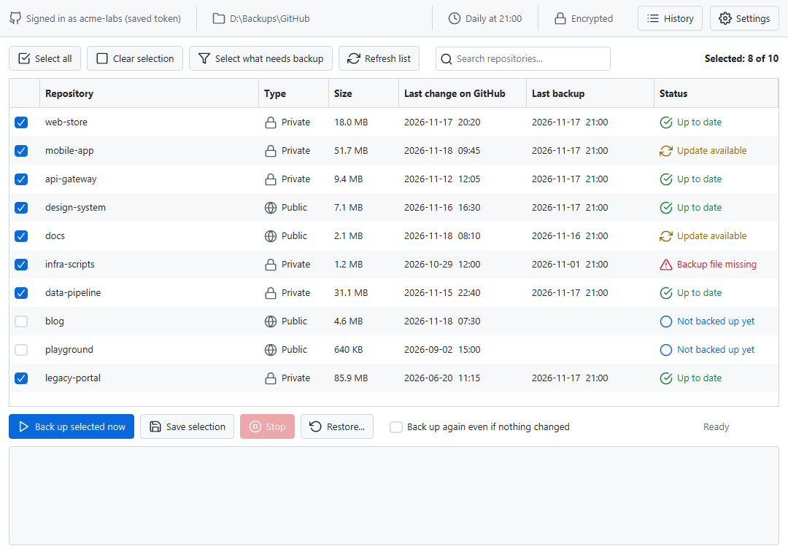
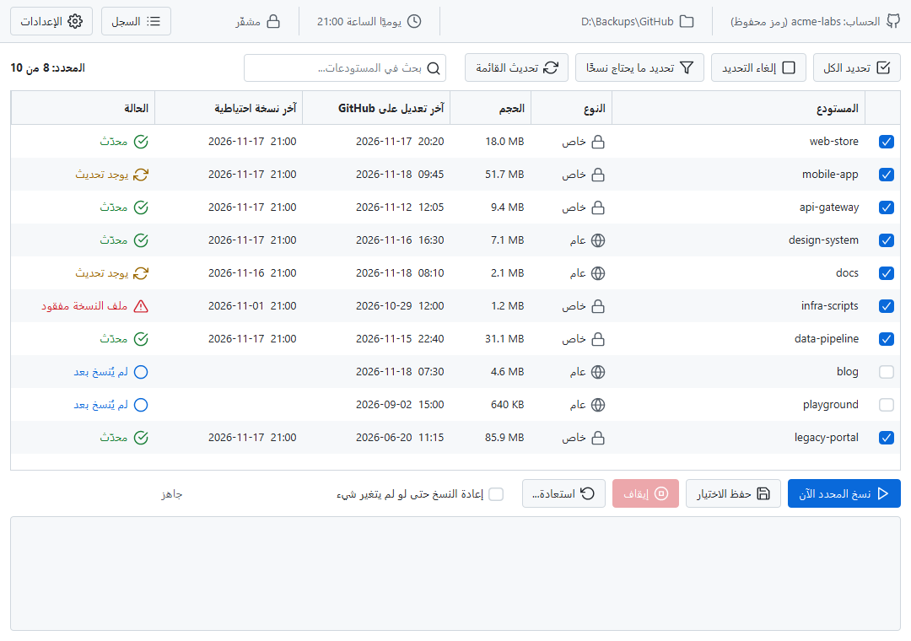
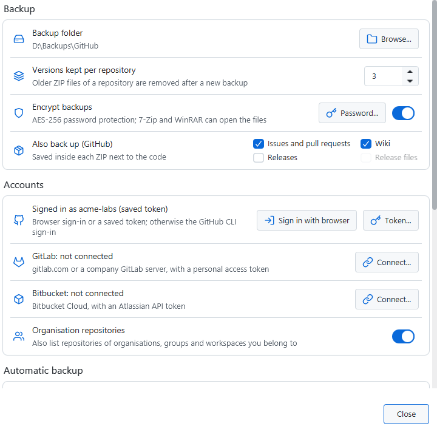
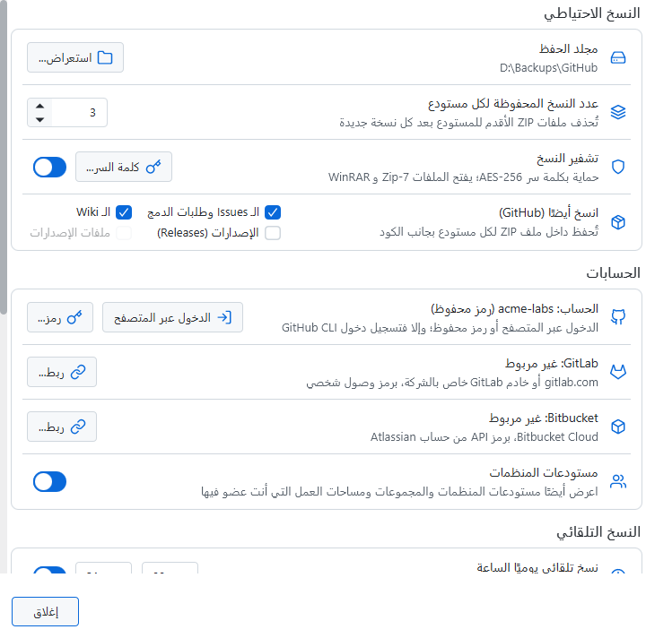

**English** | [العربية](README.ar.md)

# Git Backup

[](https://github.com/MohamedSalah-13/git-backup/actions/workflows/ci.yml)
[](https://github.com/MohamedSalah-13/git-backup/releases/latest)
[](desktop/pom.xml)
[](#requirements)
[](LICENSE)

Back up your GitHub, GitLab and Bitbucket repositories as ZIP files in a folder you choose (Google Drive, an external disk, any path). Each repository becomes its own ZIP, and a repository that has not changed since the last run is skipped.

Git Backup is a Windows desktop program. The installer carries its own Java runtime, so you need neither Java nor Git on the computer.

## Screenshots

The interface comes in English and Arabic (Arabic is laid out right to left). Switch the language in **Settings**.

| English | العربية |
|---|---|
|  |  |
|  |  |

The repositories in these pictures are made up.

## Install

1. Download `GitBackup-<version>-setup.exe` from the [latest release](https://github.com/MohamedSalah-13/git-backup/releases/latest).
2. Run it. It installs for the current user only (no administrator rights), adds a Start menu entry and a desktop shortcut, and upgrades an older version in place without touching your settings.

The installer is not digitally signed yet, so Windows SmartScreen may warn about an unknown publisher. Choose **More info**, then **Run anyway**.

From version 0.2.0 on, the program looks for a newer release shortly after it starts and installs it when you agree. Newer versions download the release in the background first, so that installing does not wait for a download; **Settings → Updates → Download updates in the background** turns that off.

## Features

- **Repository list** with the state of each backup: up to date, update available, not backed up yet, or backup file missing.
- **Three hosts:** GitHub, GitLab (gitlab.com or your company server) and Bitbucket Cloud, in one list. Organisations, groups and workspaces can be included.
- **Full backups:** each ZIP holds the files of the default branch and the complete history (every commit, branch and tag) as a git bundle.
- **Extras (GitHub):** issues and pull requests with their comments, the wiki, and the release list with optional release files.
- **Restore:** bring back a whole repository or only its files.
- **Encryption (optional):** AES-256 password protection that 7-Zip and WinRAR can open.
- **Automatic daily backup** at a time you choose, with the program running from the system tray, optionally started with Windows.
- **Backup checks:** the latest ZIP of every repository is verified regularly (all entries readable, history intact), and damaged files are reported.
- **Notifications and history** of past runs.
- **Safe sign-in:** browser sign-in or a personal access token, stored encrypted with Windows DPAPI so only your Windows user on this computer can read it.

## Requirements

- Windows.
- An account on GitHub, GitLab or Bitbucket.

## Using it

1. Open **Settings** and choose the backup folder, for example `G:\My Drive\GitBackups`.
2. Under **Accounts**, sign in to GitHub with your browser (or paste a token), and connect GitLab or Bitbucket if you use them.
3. Tick the repositories to back up and press **Back up selected now**.
4. **Save selection** keeps the ticks. The saved selection is also what the daily backup uses.

If you select every repository, repositories you create later are backed up automatically. If you select only some, new ones wait until you tick them.

### Without a window

```powershell
java -jar git-backup-desktop.jar --backup          # back up the saved selection
java -jar git-backup-desktop.jar --backup --force  # even if nothing changed
java -jar git-backup-desktop.jar --check           # verify the latest ZIP of every repository
```

Exit code: `0` success, `1` some repositories failed (or damaged backups were found), `2` could not start.

### What the backup folder looks like

```
GitBackups\
  backup-state.json                      <- state of the last backup of each repository (keep it)
  <owner>\<repository>\
    <repository>_2026-11-16_213000_a1b2c3d.zip
  gitlab\<group>\<repository>\...
  bitbucket\<workspace>\<repository>\...
```

Inside each ZIP:

- `source\` the files of the default branch at backup time.
- `<repository>.bundle` the full history: all commits, branches and tags.
- `RESTORE.txt` the steps to restore.

To restore by hand: `git clone repository.bundle repository`.

### Not included

- Git LFS file contents (only the pointers are saved).
- Issues, pull requests, the wiki and releases, unless you turn the matching extras on (GitHub only).
- A repository deleted from the account: its earlier backups stay as they are.

## Build from source

Needs JDK 25 or later and Maven 3.9 or later.

```powershell
cd desktop
mvn package
java -jar target\git-backup-desktop.jar
```

Build the Windows installer (needs the WiX Toolset 3.x):

```powershell
cd desktop
.\packaging\build-installer.ps1
```

More about the desktop program is in [desktop/README.md](desktop/README.md) (Arabic).

## PowerShell scripts

The repository also holds the original PowerShell version, which needs Git for Windows and the GitHub CLI (`gh auth login`) and backs up GitHub repositories only. See [README.ar.md](README.ar.md) for how to use `backup-gui.cmd`, `backup-repos.ps1` and `install-schedule.ps1`.

## License

All rights reserved. See [LICENSE](LICENSE).
